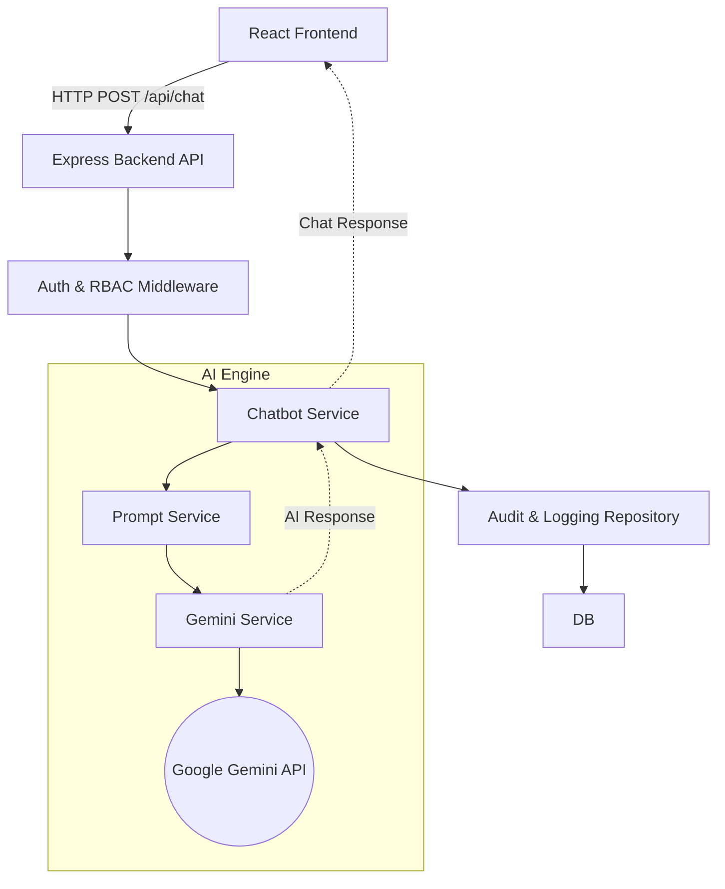

# AI-Powered Rehab Chatbot - System Architecture & Documentation

## 1. Overview
The Rehab Chatbot is an AI-powered proof-of-concept (POC) application designed to assist users (Admin, Project Managers, Homeowners, etc.) in a rehab management system. It leverages Google's Gemini Large Language Models (LLM) to directly answer user queries and provide conversational assistance.

## 2. Technology Stack

### Frontend
- **React.js (v18)**: Core UI library.
- **Vite**: Ultra-fast build tool and development server.
- **Material UI (MUI)**: Component library for a modern, responsive, and accessible interface.
- **React Query (@tanstack)**: Server state management, caching, and data fetching.
- **Axios**: HTTP client for API communication.

### Backend
- **Node.js & Express.js**: Server environment and web framework for building RESTful APIs.
- **Sequelize ORM & PostgreSQL**: Relational database management.
- **Google Cloud Vertex AI SDK (`@google-cloud/vertexai`)**: Integration with Google Cloud Platform (GCP) for AI inference. Uses **`gemini-2.5-flash`** for chat generation.
- **JWT & Bcryptjs**: Authentication and secure password hashing.
- **Winston & Morgan**: Application logging and HTTP request logging.

---

## 3. Application Flow & Architecture

The application follows a classic client-server model augmented with AI services. 

### High-Level Architecture Diagram

### Step-by-Step Flow

1. **User Interaction**: The user logs in via the React frontend and types a message into the chat interface.
2. **API Request**: The frontend sends an authenticated HTTP request (with JWT) to the backend API (`/api/chat`).
3. **Authentication & Authorization**: The Express middleware verifies the JWT token and checks Role-Based Access Control (RBAC) to ensure the user has permission to access the chatbot.
4. **Prompt Construction**: The `prompt.service` formats the user query and the system prompt/persona instructions into a cohesive prompt for the LLM.
5. **AI Inference**: The `gemini.service` sends the constructed prompt directly to the **Google Gemini API**.
6. **Logging & Auditing**: Before sending the response back, the system logs the interaction in `chat_audit_logs` and `ai_usage_logs` (tracking tokens and performance).
7. **Response Delivery**: The AI's response is formatted and sent back to the React frontend, where it is displayed to the user.

---

## 4. Database Schema (Key Entities)

- **Users / Roles**: Manages authentication and RBAC (Admin, Viewer, Project Manager, etc.).
- **Chat Sessions & Messages**: Stores conversation history so the LLM can maintain conversational context.
- **Audit Logs / AI Usage Logs**: Tracks token usage, latency, and user interactions for security and billing purposes.

## 5. Security & Best Practices
- **Role-Based Access Control**: Ensures users only see responses generated from data they are authorized to view.
- **Prepared Statements**: Sequelize protects against SQL injection.
