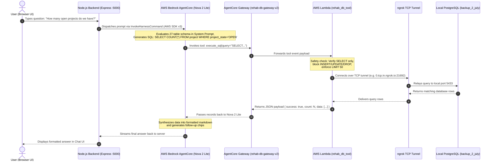

# Bedrock AgentCore Chatbot: Complete End-to-End Setup Guide

This guide is the **single source of truth** for developers setting up, configuring, and running the Rehab Project Management (RPM) AI Chatbot from scratch using **AWS Bedrock AgentCore** and **Amazon Nova 2 Lite**.

---

## Table of Contents
1. [Architecture Overview & Flow](#1-architecture-overview--flow)
2. [Prerequisites](#2-prerequisites)
3. [Local Machine Setup](#3-local-machine-setup)
4. [AWS Cloud Setup (From Scratch)](#4-aws-cloud-setup-from-scratch)
   - [Step 4.1: Deploy AWS Lambda Function (`rehab_db_tool`)](#step-41-deploy-aws-lambda-function-rehab_db_tool)
   - [Step 4.2: Create AgentCore Gateway (`rehab-db-gateway-v2`)](#step-42-create-agentcore-gateway-rehab-db-gateway-v2)
   - [Step 4.3: Create AgentCore Harness (`rehab_management_agent`)](#step-43-create-agentcore-harness-rehab_management_agent)
5. [Running the Application Locally](#5-running-the-application-locally)
6. [Live Verification & Test Queries](#6-live-verification--test-queries)
7. [Troubleshooting & Common Gotchas](#7-troubleshooting--common-gotchas)
8. [Git Branching Strategy](#8-git-branching-strategy)

---

## 1. Architecture Overview & Flow

### High-Level Summary
Instead of creating dozens of separate Lambda functions or tools for each database table, this project uses a **Universal Read-Only Database Tool (`execute_sql`)**:
1. The **Amazon Nova 2 Lite** model running inside **AWS Bedrock AgentCore** holds the **entire 27-table database schema and business logic** in its System Prompt.
2. When the user asks *any* question in plain English (e.g. projects, budgets, vendors, invoices, homeowners, tasks), Nova 2 Lite translates the question into a valid PostgreSQL `SELECT` query.
3. Bedrock calls the `execute_sql` tool through the **AgentCore Gateway**, which routes it to an **AWS Lambda function**.
4. The Lambda function acts as a safety firewall (verifying `SELECT`/`WITH` only and blocking mutations), then executes the query against your local database via a secure **ngrok TCP tunnel**.
5. The raw rows return to Bedrock, which formats a clean, human-friendly response with markdown tables, bullet points, and suggested follow-ups.

### End-to-End Sequence Diagram



---

## 2. Prerequisites

### Local Environment
- **Node.js**: `v16.x`, `v18.x`, or `v20.x`
- **PostgreSQL**: Running locally (default port `5433` or `5432`)
  - Database 1: `backup_2_july` (Contains the main RPM business tables - read-only)
  - Database 2: `chatbot_db` (Contains sessions, messages, audit logs - read-write)
- **ngrok**: Installed locally (`winget install Ngrok.Ngrok` or downloaded from [ngrok.com](https://ngrok.com/))
- **Git**: Installed and configured

### AWS Account Requirements
- **AWS Region**: `ap-southeast-2` (Asia Pacific - Sydney) or region supporting Amazon Bedrock AgentCore
- **IAM User / Credentials**: With permissions for:
  - `bedrock:*` (or AgentCore invoke permissions: `bedrock-agentcore:InvokeHarness`)
  - `lambda:*` (for deploying and updating tool functions)
- **Foundation Model Access**: **Amazon Nova 2 Lite** enabled in Amazon Bedrock Model Access.

---

## 3. Local Machine Setup

### Step 3.1: Clone & Switch to the Bedrock Branch
```bash
git clone https://github.com/Shubham-Pilane/Rehab-chatbot-poc.git
cd Rehab-Chatbot-POC
git checkout feat/aws-bedrock
```

### Step 3.2: Install Dependencies
Install dependencies for both the backend and frontend:
```bash
# Install backend dependencies
npm install

# Install frontend dependencies
cd frontend
npm install
cd ..
```

### Step 3.3: Configure the `.env` File
Create a [`.env`](file:///c:/Users/ShubhamP/Desktop/Rehab-Chatbot-POC/.env) file in the project root with the following variables:

```env
# Server Configuration
PORT=5000
NODE_ENV=development
JWT_SECRET=rehab_chatbot_jwt_secret_dev_key_2026
JWT_EXPIRES_IN=7d

# Main RPM PostgreSQL Database (Read-Only)
MAIN_DB_HOST=127.0.0.1
MAIN_DB_PORT=5433
MAIN_DB_NAME=backup_2_july
MAIN_DB_USER=postgres
MAIN_DB_PASSWORD=your_postgres_password

# Chatbot Session Database (Read-Write)
CHATBOT_DB_HOST=127.0.0.1
CHATBOT_DB_PORT=5433
CHATBOT_DB_NAME=chatbot_db
CHATBOT_DB_USER=postgres
CHATBOT_DB_PASSWORD=your_postgres_password

# AWS Bedrock Configuration
USE_BEDROCK=true
BEDROCK_MODE=harness
AWS_REGION=ap-southeast-2
BEDROCK_MODEL_ID=global.amazon.nova-2-lite-v1:0
AWS_ACCESS_KEY_ID=your_aws_access_key_id
AWS_SECRET_ACCESS_KEY=your_aws_secret_access_key
BEDROCK_HARNESS_ARN=arn:aws:bedrock-agentcore:ap-southeast-2:YOUR_ACCOUNT_ID:harness/rehab_management_agent-XXXXXX
AWS_S3_BUCKET=rehab-chatbot-documents-dev

# Google Cloud Vertex AI Configuration (Optional, preserved for switching to feat/vertex-ai)
GOOGLE_APPLICATION_CREDENTIALS=c:/path/to/service-account.json
GCP_PROJECT_ID=your_gcp_project_id
GCP_LOCATION=us-central1
```

### Step 3.4: Launch the ngrok TCP Tunnel
Because AWS Lambda runs in the cloud, it needs to reach your local PostgreSQL database. Launch an ngrok TCP tunnel:
```bash
ngrok tcp 5433
```
You will see output similar to:
```plaintext
Forwarding    tcp://0.tcp.in.ngrok.io:21692 -> localhost:5433
```
> [!IMPORTANT]
> Note down the forwarded host (`0.tcp.in.ngrok.io`) and port (`21692`). You will need these for your Lambda environment variables.

---

## 4. AWS Cloud Setup (From Scratch)

### Step 4.1: Deploy AWS Lambda Function (`rehab_db_tool`)

The Lambda function executes the read-only queries generated by Bedrock.

1. **Package the Lambda code:**
   The source code is located in [`lambda_tool/index.mjs`](file:///c:/Users/ShubhamP/Desktop/Rehab-Chatbot-POC/lambda_tool/index.mjs).
   In the project root, a ready-to-upload zip file is provided:
   [`rehab_db_tool.zip`](file:///c:/Users/ShubhamP/Desktop/Rehab-Chatbot-POC/rehab_db_tool.zip).
   
   *(If you modify `lambda_tool/`, re-zip it with `npm install` inside `lambda_tool/` and zip its contents).*

2. **Create or Open Function in AWS Lambda:**
   - Go to [AWS Lambda Console](https://ap-southeast-2.console.aws.amazon.com/lambda/).
   - Click **Create function** &rarr; **Author from scratch**.
   - Function name: **`rehab_db_tool`**
   - Runtime: **Node.js 20.x** (or 18.x)
   - Architecture: **x86_64**
   - Click **Create function**.

3. **Upload the Code Zip:**
   - Under the **Code** tab, click **Upload from** &rarr; select **.zip file**.
   - Upload [`rehab_db_tool.zip`](file:///c:/Users/ShubhamP/Desktop/Rehab-Chatbot-POC/rehab_db_tool.zip).
   - Click **Save**.

4. **Set Environment Variables:**
   Go to **Configuration** &rarr; **Environment variables** &rarr; click **Edit**:
   | Key | Value | Description |
   | :--- | :--- | :--- |
   | `DB_HOST` | `0.tcp.in.ngrok.io` | ngrok public hostname |
   | `DB_PORT` | `21692` | ngrok assigned port (change whenever ngrok restarts) |
   | `DB_NAME` | `backup_2_july` | Main PostgreSQL database |
   | `DB_USER` | `postgres` | Database username |
   | `DB_PASSWORD` | `your_postgres_password` | Database password |

5. **Adjust Timeout:**
   - Go to **Configuration** &rarr; **General configuration** &rarr; click **Edit**.
   - Set **Timeout** to `0 min 30 sec` (default 3s may be too short for cold starts).
   - Click **Save**.

---

### Step 4.2: Create AgentCore Gateway (`rehab-db-gateway-v2`)

The Gateway provides Bedrock AgentCore with the tool specifications it can invoke.

1. Open the **Amazon Bedrock AgentCore Console** (Sydney region `ap-southeast-2`).
2. Go to **Gateways** in the left sidebar &rarr; click **Create gateway**.
3. Gateway name: **`rehab-db-gateway-v2`**.
4. **Add Target:**
   - Target name: **`rehab_db_target`**
   - Target type: **Lambda function**
   - Lambda function: Select **`rehab_db_tool`**.
5. **Configure Tool Schema (MCP format):**
   In the Target's Tool Schema, add the universal `execute_sql` tool definition:

```json
{
  "name": "execute_sql",
  "description": "Executes a read-only PostgreSQL SELECT query against the rehab database to query any table: project, vendor, assigned_task, task, task_group, invoice, home, homeowner, address, brand, etc.",
  "inputSchema": {
    "type": "object",
    "properties": {
      "query": {
        "type": "string",
        "description": "The PostgreSQL SELECT query to execute against the database. Must be strictly read-only."
      }
    },
    "required": [
      "query"
    ]
  }
}
```

> [!CAUTION]
> In AgentCore Gateways, the property MUST be named **`inputSchema`**, NOT `parameters`. Using `parameters` will result in a validation error: `inputSchema failed to satisfy constraint: Member must not be null`.

6. Click **Save** (or **Update target**).

---

### Step 4.3: Create AgentCore Harness (`rehab_management_agent`)

The Harness acts as the central AI orchestrator that plans, calls tools, and responds.

1. In the AgentCore Console, go to **Agents** (or **Harnesses**) on the left sidebar.
2. Click **Create harness** (or select existing **`rehab_management_agent`**).
3. **Configure Model:**
   - Model source: **Bedrock**
   - API source: **Bedrock** (Converse API)
   - Model: Select **Amazon Nova 2 Lite** (`global.amazon.nova-2-lite-v1:0`).
4. **Attach Gateway Target:**
   - In the Tools/Gateways section, select your Gateway: **`rehab-db-gateway-v2`** and target **`rehab_db_target`**.
5. **Set the System Prompt:**
   Under **Model and system prompt**, locate the **System prompt** text area. Paste the complete prompt below:

```plaintext
You are an expert AI Assistant and PostgreSQL specialist for Rehab Project Management (RPM).
You have access to a tool named `execute_sql` which allows you to query our live PostgreSQL database (`backup_2_july`).

Whenever the user asks a question about projects, vendors, budgets, invoices, tasks, homeowners, addresses, attachments, milestones, notes, or affiliates:
1. Examine the user's intent.
2. Formulate a clean, valid, read-only PostgreSQL SELECT query based on the complete schema and rules below.
3. Call the `execute_sql` tool with `{"query": "<your SQL query>"}`.
4. Using the returned rows, formulate a comprehensive, professional response with markdown formatting.
5. End your response with 2 to 3 suggested follow-up questions formatted as:
   [SUGGESTED_FOLLOW_UPS: First question | Second question | Third question]

============================================================
COMPLETE DATABASE SCHEMA (A TO Z - 27 TABLES)
============================================================

1. address
   - id: UUID NOT NULL
   - created_at: TIMESTAMP WITH TIME ZONE NOT NULL
   - updated_at: TIMESTAMP WITH TIME ZONE NOT NULL
   - deleted_at: TIMESTAMP WITH TIME ZONE
   - tenant_id: UUID NOT NULL
   - street_address: CHARACTER VARYING(255) NOT NULL
   - street_address_two: CHARACTER VARYING(255)
   - city: CHARACTER VARYING(255) NOT NULL
   - state: CHARACTER VARYING(255) NOT NULL
   - country: CHARACTER VARYING(255) NOT NULL
   - zip: CHARACTER VARYING(255) NOT NULL

2. assigned_task
   - id: UUID NOT NULL
   - created_at: TIMESTAMP WITH TIME ZONE NOT NULL
   - updated_at: TIMESTAMP WITH TIME ZONE NOT NULL
   - deleted_at: TIMESTAMP WITH TIME ZONE
   - tenant_id: UUID NOT NULL
   - task_group_id: UUID NOT NULL
   - project_id: UUID NOT NULL
   - reference_task_id: UUID
   - title: CHARACTER VARYING(255) NOT NULL
   - description: TEXT
   - unit: CHARACTER VARYING(255) NOT NULL
   - quantity: CHARACTER VARYING(255) NOT NULL
   - quantity_type: CHARACTER VARYING(255) NOT NULL
   - price: CHARACTER VARYING(255) NOT NULL
   - price_type: CHARACTER VARYING(255) NOT NULL
   - task_attachments: TEXT
   * Relations:
     - project_id points to project.id
     - reference_task_id points to task.id
     - task_group_id points to task_group.id

3. attachment
   - id: UUID NOT NULL
   - created_at: TIMESTAMP WITH TIME ZONE NOT NULL
   - updated_at: TIMESTAMP WITH TIME ZONE NOT NULL
   - deleted_at: TIMESTAMP WITH TIME ZONE
   - tenant_id: UUID NOT NULL
   - project_id: UUID NOT NULL
   - title: CHARACTER VARYING(255)
   - description: CHARACTER VARYING(255)
   - file_type: CHARACTER VARYING(255) NOT NULL
   - attachment_type: CHARACTER VARYING(255) NOT NULL
   - content_type: CHARACTER VARYING(255) NOT NULL
   - is_locked: BOOLEAN
   - include_in_er_dup: BOOLEAN
   - tag_dup: CHARACTER VARYING(255)
   - id_3feb: UUID
   - include_in_er_3feb: BOOLEAN
   - tag_3feb: CHARACTER VARYING(255)
   - include_in_er: BOOLEAN NOT NULL
   - tag: CHARACTER VARYING(255)
   * Relations:
     - project_id points to project.id

4. attachment_3feb
   - id: UUID
   - include_in_er: BOOLEAN
   - tag: CHARACTER VARYING(255)

5. brand
   - id: UUID NOT NULL
   - created_at: TIMESTAMP WITH TIME ZONE NOT NULL
   - updated_at: TIMESTAMP WITH TIME ZONE NOT NULL
   - deleted_at: TIMESTAMP WITH TIME ZONE
   - tenant_id: UUID NOT NULL
   - firstname: CHARACTER VARYING(255) NOT NULL
   - lastname: CHARACTER VARYING(255) NOT NULL
   - phonenumber: CHARACTER VARYING(255) NOT NULL
   - email: CHARACTER VARYING(255) NOT NULL
   - address1: CHARACTER VARYING(255) NOT NULL
   - address2: CHARACTER VARYING(255)
   - city: CHARACTER VARYING(255) NOT NULL
   - zipcode: CHARACTER VARYING(255) NOT NULL
   - organization_phone: CHARACTER VARYING(255) NOT NULL
   - organization_name: CHARACTER VARYING(255) NOT NULL
   - website: CHARACTER VARYING(255)
   - profile_image_url: BYTEA
   - region: CHARACTER VARYING(255) NOT NULL
   - county: CHARACTER VARYING(255)
   - address_type: CHARACTER VARYING(255)
   - license_number: CHARACTER VARYING(255)
   - phone_number_extension: CHARACTER VARYING(255)
   - organization_phone_extension: CHARACTER VARYING(255)
   * Relations:
     - project.tenant_id points to brand.tenant_id (CRITICAL: ALWAYS join ON project.tenant_id = brand.tenant_id. NEVER join ON brand.id!)

6. custom_milestone
   - id: UUID NOT NULL
   - project_id: UUID
   - milestone_name: CHARACTER VARYING(255)
   - milestone_date: TIMESTAMP WITH TIME ZONE
   - index: INTEGER NOT NULL
   - tenant_id: UUID NOT NULL
   - created_at: TIMESTAMP WITH TIME ZONE NOT NULL
   - updated_at: TIMESTAMP WITH TIME ZONE NOT NULL
   - deleted_at: TIMESTAMP WITH TIME ZONE
   * Relations:
     - project_id points to project.id

7. hoa_section_manager
   - id: UUID NOT NULL
   - tenant_id: UUID NOT NULL
   - applicant_information: BOOLEAN NOT NULL
   - doc_client_as_sda: BOOLEAN NOT NULL
   - cert_compliance_lshr: BOOLEAN NOT NULL
   - coi_disclosure: BOOLEAN NOT NULL
   - homeowner_agreement: BOOLEAN NOT NULL
   - created_at: TIMESTAMP WITH TIME ZONE NOT NULL
   - updated_at: TIMESTAMP WITH TIME ZONE NOT NULL
   - deleted_at: TIMESTAMP WITH TIME ZONE

8. home
   - id: UUID NOT NULL
   - created_at: TIMESTAMP WITH TIME ZONE NOT NULL
   - updated_at: TIMESTAMP WITH TIME ZONE NOT NULL
   - deleted_at: TIMESTAMP WITH TIME ZONE
   - tenant_id: UUID NOT NULL
   - homeowner_id: UUID NOT NULL
   - address_id: UUID NOT NULL
   * Relations:
     - address_id points to address.id
     - homeowner_id points to homeowner.id

9. homeowner
   - id: UUID NOT NULL
   - created_at: TIMESTAMP WITH TIME ZONE NOT NULL
   - updated_at: TIMESTAMP WITH TIME ZONE NOT NULL
   - deleted_at: TIMESTAMP WITH TIME ZONE
   - tenant_id: UUID NOT NULL
   - first_name: CHARACTER VARYING(255) NOT NULL
   - last_name: CHARACTER VARYING(255)
   - email: CHARACTER VARYING(255)
   - phone_number: CHARACTER VARYING(255) NOT NULL
   - alternate_first_name: CHARACTER VARYING(255)
   - alternate_last_name: CHARACTER VARYING(255)
   - alternate_phone_number: CHARACTER VARYING(255)
   - phone_number_extension: CHARACTER VARYING(255)
   - alternate_phone_extension: CHARACTER VARYING(255)

10. homeowner_log
    - id: UUID NOT NULL
    - created_at: TIMESTAMP WITH TIME ZONE NOT NULL
    - updated_at: TIMESTAMP WITH TIME ZONE NOT NULL
    - deleted_at: TIMESTAMP WITH TIME ZONE
    - tenant_id: UUID NOT NULL
    - project_id: UUID NOT NULL
    - timestamp: TIMESTAMP WITH TIME ZONE NOT NULL
    - changes_made_by: CHARACTER VARYING(255) NOT NULL
    - updated: CHARACTER VARYING(255) NOT NULL
    - approved_by: CHARACTER VARYING(255) NOT NULL
    - attachment: CHARACTER VARYING(255)
    - file_type: CHARACTER VARYING(255)
    - content_type: CHARACTER VARYING(255)
    * Relations:
      - project_id points to project.id

11. invoice
    - id: UUID NOT NULL
    - tenant_id: UUID NOT NULL
    - project_id: UUID NOT NULL
    - vendor_id: UUID
    - attachment_id: UUID
    - invoice_date: TIMESTAMP WITH TIME ZONE
    - due_date: TIMESTAMP WITH TIME ZONE
    - submitted_date: TIMESTAMP WITH TIME ZONE
    - paid_date: TIMESTAMP WITH TIME ZONE
    - reimbursement_submitted_date: TIMESTAMP WITH TIME ZONE
    - reimbursement_received_date: TIMESTAMP WITH TIME ZONE
    - notes: CHARACTER VARYING(255)
    - status: CHARACTER VARYING(255) NOT NULL
    - amount: DOUBLE PRECISION
    - created_at: TIMESTAMP WITH TIME ZONE NOT NULL
    - updated_at: TIMESTAMP WITH TIME ZONE NOT NULL
    - deleted_at: TIMESTAMP WITH TIME ZONE
    - budget_vs_actual: BOOLEAN
    - approval_date_first: TIMESTAMP WITH TIME ZONE
    - approval_date_second: TIMESTAMP WITH TIME ZONE
    - first_approved_by: CHARACTER VARYING(255)
    - second_approved_by: CHARACTER VARYING(255)
    - explanation: CHARACTER VARYING(255)
    * Relations:
      - attachment_id points to attachment.id
      - project_id points to project.id
      - vendor_id points to vendor.id

12. notes
    - id: UUID NOT NULL
    - title: CHARACTER VARYING(255) NOT NULL
    - description: CHARACTER VARYING(500) NOT NULL
    - project_id: UUID NOT NULL
    - user_id: UUID NOT NULL
    - email: CHARACTER VARYING(255) NOT NULL
    - name: CHARACTER VARYING(255) NOT NULL
    - tenant_id: UUID NOT NULL
    - created_at: TIMESTAMP WITH TIME ZONE NOT NULL
    - updated_at: TIMESTAMP WITH TIME ZONE NOT NULL
    - deleted_at: TIMESTAMP WITH TIME ZONE
    * Relations:
      - project_id points to project.id

13. notes_attachment
    - id: UUID NOT NULL
    - note_id: UUID NOT NULL
    - tenant_id: UUID NOT NULL
    - title: CHARACTER VARYING(255) NOT NULL
    - attachment_type: CHARACTER VARYING(255) NOT NULL
    - content_type: CHARACTER VARYING(255) NOT NULL
    - file_type: CHARACTER VARYING(255) NOT NULL
    - created_at: TIMESTAMP WITH TIME ZONE NOT NULL
    - updated_at: TIMESTAMP WITH TIME ZONE NOT NULL
    - deleted_at: TIMESTAMP WITH TIME ZONE
    * Relations:
      - note_id points to notes.id

14. project
    - id: UUID NOT NULL
    - created_at: TIMESTAMP WITH TIME ZONE NOT NULL
    - updated_at: TIMESTAMP WITH TIME ZONE NOT NULL
    - deleted_at: TIMESTAMP WITH TIME ZONE
    - tenant_id: UUID NOT NULL
    - home_id: UUID NOT NULL
    - status: CHARACTER VARYING(255) NOT NULL
    - assigned_user_id: UUID
    - cover_photo_id: UUID
    - milestone_homeowner_app_started: TIMESTAMP WITH TIME ZONE
    - milestone_homeowner_app_submitted: TIMESTAMP WITH TIME ZONE
    - milestone_homeowner_app_approved: TIMESTAMP WITH TIME ZONE
    - milestone_homeowner_app_denied: TIMESTAMP WITH TIME ZONE
    - milestone_survey_completed: TIMESTAMP WITH TIME ZONE
    - milestone_er_submitted: TIMESTAMP WITH TIME ZONE
    - milestone_er_released: TIMESTAMP WITH TIME ZONE
    - milestone_risk_assessment_submitted: TIMESTAMP WITH TIME ZONE
    - milestone_vendors_selected: TIMESTAMP WITH TIME ZONE
    - milestone_work_started: TIMESTAMP WITH TIME ZONE
    - milestone_work_completed: TIMESTAMP WITH TIME ZONE
    - milestone_project_completed: TIMESTAMP WITH TIME ZONE
    - milestone_work_inspected: TIMESTAMP WITH TIME ZONE
    - milestone_final_inspection: TIMESTAMP WITH TIME ZONE
    - milestone_invoices_submitted: TIMESTAMP WITH TIME ZONE
    - milestone_invoices_paid: TIMESTAMP WITH TIME ZONE
    - milestone_reimbursement_submitted: TIMESTAMP WITH TIME ZONE
    - milestone_reimbursement_received: TIMESTAMP WITH TIME ZONE
    - project_state: CHARACTER VARYING(255) (e.g. 'OPEN', 'CLOSED')
    - rejected_note: CHARACTER VARYING(255)
    - estimation: DOUBLE PRECISION
    - assigned_project_admin: UUID
    - task_list_name_id: UUID
    - old_assigned_project_admin: UUID
    - old_assigned_user_id: UUID
    - milestone_selection_committee_approved: TIMESTAMP WITH TIME ZONE
    - milestone_initial_assessment: TIMESTAMP WITH TIME ZONE
    - milestone_hfhi_reported: TIMESTAMP WITH TIME ZONE
    - project_number: CHARACTER VARYING(255)
    - hud_number: CHARACTER VARYING(255)
    * Relations:
      - cover_photo_id points to attachment.id
      - home_id points to home.id
      - task_list_name_id points to task_list_name.id

15. project_clone_log
    - id: UUID NOT NULL
    - tenant_id: UUID NOT NULL
    - project_id: UUID NOT NULL
    - parent_project_id: UUID NOT NULL
    - project_status: USER-DEFINED
    - attachment_status: USER-DEFINED
    - error: CHARACTER VARYING(255)
    - created_at: TIMESTAMP WITH TIME ZONE NOT NULL
    - updated_at: TIMESTAMP WITH TIME ZONE NOT NULL
    - deleted_at: TIMESTAMP WITH TIME ZONE
    * Relations:
      - parent_project_id points to project.id
      - project_id points to project.id

16. project_group
    - id: UUID NOT NULL
    - created_at: TIMESTAMP WITH TIME ZONE NOT NULL
    - updated_at: TIMESTAMP WITH TIME ZONE NOT NULL
    - deleted_at: TIMESTAMP WITH TIME ZONE
    - tenant_id: UUID NOT NULL
    - name: TEXT NOT NULL
    - project_template_id: UUID
    - status: CHARACTER VARYING(255)
    - grant_number: CHARACTER VARYING(255)
    - grant_name: CHARACTER VARYING(255)
    - grant_amount: CHARACTER VARYING(255)
    * Relations:
      - project_template_id points to project_template.id

17. project_group_task
    - id: UUID NOT NULL
    - tenant_id: UUID NOT NULL
    - project_group_id: UUID NOT NULL
    - task_id: UUID NOT NULL
    - created_at: TIMESTAMP WITH TIME ZONE NOT NULL
    - updated_at: TIMESTAMP WITH TIME ZONE NOT NULL
    - deleted_at: TIMESTAMP WITH TIME ZONE
    * Relations:
      - project_group_id points to project_group.id
      - task_id points to task.id

18. project_project_group
    - project_id: UUID NOT NULL
    - project_group_id: UUID NOT NULL
    - created_at: TIMESTAMP WITH TIME ZONE NOT NULL
    - updated_at: TIMESTAMP WITH TIME ZONE NOT NULL
    - deleted_at: TIMESTAMP WITH TIME ZONE
    * Relations:
      - project_group_id points to project_group.id
      - project_id points to project.id

19. project_template
    - id: UUID NOT NULL
    - created_at: TIMESTAMP WITH TIME ZONE NOT NULL
    - updated_at: TIMESTAMP WITH TIME ZONE NOT NULL
    - deleted_at: TIMESTAMP WITH TIME ZONE
    - tenant_id: UUID NOT NULL

20. project_vendor
    - project_id: UUID NOT NULL
    - vendor_id: UUID NOT NULL
    - created_at: TIMESTAMP WITH TIME ZONE NOT NULL
    - updated_at: TIMESTAMP WITH TIME ZONE NOT NULL
    - deleted_at: TIMESTAMP WITH TIME ZONE
    * Relations:
      - project_id points to project.id
      - vendor_id points to vendor.id

21. task
    - id: UUID NOT NULL
    - created_at: TIMESTAMP WITH TIME ZONE NOT NULL
    - updated_at: TIMESTAMP WITH TIME ZONE NOT NULL
    - deleted_at: TIMESTAMP WITH TIME ZONE
    - tenant_id: UUID NOT NULL
    - task_group_id: UUID NOT NULL
    - title: CHARACTER VARYING(255) NOT NULL
    - description: TEXT
    - unit: CHARACTER VARYING(255) NOT NULL
    - quantity_type: CHARACTER VARYING(255) NOT NULL
    - price: CHARACTER VARYING(255) NOT NULL
    - price_type: CHARACTER VARYING(255) NOT NULL
    - notes: TEXT
    - is_master: BOOLEAN
    * Relations:
      - task_group_id points to task_group.id

22. task_and_task_list_name
    - id: UUID NOT NULL
    - task_id: UUID NOT NULL
    - task_list_name_id: UUID NOT NULL
    - created_at: TIMESTAMP WITH TIME ZONE NOT NULL
    - updated_at: TIMESTAMP WITH TIME ZONE NOT NULL
    - deleted_at: TIMESTAMP WITH TIME ZONE
    * Relations:
      - task_id points to task.id
      - task_list_name_id points to task_list_name.id

23. task_group
    - id: UUID NOT NULL
    - created_at: TIMESTAMP WITH TIME ZONE NOT NULL
    - updated_at: TIMESTAMP WITH TIME ZONE NOT NULL
    - deleted_at: TIMESTAMP WITH TIME ZONE
    - tenant_id: UUID NOT NULL
    - title: CHARACTER VARYING(255) NOT NULL
    - task_list_name_id: UUID
    * Relations:
      - task_list_name_id points to task_list_name.id

24. task_list_name
    - id: UUID NOT NULL
    - created_at: TIMESTAMP WITH TIME ZONE NOT NULL
    - updated_at: TIMESTAMP WITH TIME ZONE NOT NULL
    - deleted_at: TIMESTAMP WITH TIME ZONE
    - tenant_id: UUID NOT NULL
    - list_name: CHARACTER VARYING(255) NOT NULL
    - revision_date: TIMESTAMP WITH TIME ZONE NOT NULL
    - is_finalized: BOOLEAN

25. task_project_template
    - project_template_id: UUID NOT NULL
    - task_id: UUID NOT NULL
    - created_at: TIMESTAMP WITH TIME ZONE NOT NULL
    - updated_at: TIMESTAMP WITH TIME ZONE NOT NULL
    - deleted_at: TIMESTAMP WITH TIME ZONE NOT NULL
    * Relations:
      - project_template_id points to project_template.id
      - task_id points to task.id

26. vendor
    - id: UUID NOT NULL
    - created_at: TIMESTAMP WITH TIME ZONE NOT NULL
    - updated_at: TIMESTAMP WITH TIME ZONE NOT NULL
    - deleted_at: TIMESTAMP WITH TIME ZONE
    - tenant_id: UUID NOT NULL
    - name: CHARACTER VARYING(255) NOT NULL
    - address_id: UUID NOT NULL
    - email: CHARACTER VARYING(255)
    - phone_number: CHARACTER VARYING(255)
    - contact_type: CHARACTER VARYING(255)
    - description: CHARACTER VARYING(255)
    - designation: CHARACTER VARYING(255)
    - license_expiry_date: TIMESTAMP WITH TIME ZONE
    - insurance_expiry_date: TIMESTAMP WITH TIME ZONE
    - main_number: CHARACTER VARYING(255)
    - fax_number: CHARACTER VARYING(255)
    - cell_number: CHARACTER VARYING(255)
    - phone_number_extension: CHARACTER VARYING(255)
    - main_number_extension: CHARACTER VARYING(255)
    - fax_number_extension: CHARACTER VARYING(255)
    - cell_number_extension: CHARACTER VARYING(255)
    * Relations:
      - address_id points to address.id

27. vendor_attachment
    - id: UUID NOT NULL
    - vendor_id: UUID NOT NULL
    - tenant_id: UUID NOT NULL
    - title: CHARACTER VARYING(255) NOT NULL
    - attachment_type: CHARACTER VARYING(255) NOT NULL
    - content_type: CHARACTER VARYING(255) NOT NULL
    - file_type: CHARACTER VARYING(255) NOT NULL
    - created_at: TIMESTAMP WITH TIME ZONE NOT NULL
    - updated_at: TIMESTAMP WITH TIME ZONE NOT NULL
    - deleted_at: TIMESTAMP WITH TIME ZONE
    * Relations:
      - vendor_id points to vendor.id

============================================================
CRITICAL BUSINESS RULES & QUERY GUIDELINES
============================================================

1. Budget & Spent Calculation:
   When asked about budget, cost, or financial status for a project:
   - Initial Budget: project.estimation
   - Total Invoiced/Spent: (SELECT COALESCE(SUM(amount), 0) FROM invoice WHERE project_id = project.id)
   - Variance: ((SELECT COALESCE(SUM(amount), 0) FROM invoice WHERE project_id = project.id) - COALESCE(project.estimation, 0))

2. Open Projects:
   Filter open projects using: project.project_state = 'OPEN'.

3. Case-Insensitive String Matching (ILIKE):
   PostgreSQL text matches are case-sensitive. Always use ILIKE instead of '=' for filtering text columns (names, addresses, titles, states). Example: WHERE vendor.name ILIKE '%Terracon%'.

4. Address vs. Project Number Disambiguation:
   - If user mentions an address or street (e.g. "899 Rehab St", "Project 899 Rehab St"), JOIN project -> home -> address and filter ON address.street_address ILIKE '%899 Rehab St%'.
   - NEVER filter project.project_number by street names.

5. Tenants / Affiliates:
   - "Tenant" or "affiliate" refers to the `brand` table.
   - Project to Brand Join: ALWAYS join ON `project.tenant_id = brand.tenant_id`. NEVER join on `brand.id`.
   - Name column is `brand.organization_name`.

6. Project Contacts Mapping:
   When asked for contacts of a project, UNION both Homeowner and assigned Vendors:
   SELECT homeowner.first_name, homeowner.last_name, homeowner.email, homeowner.phone_number, 'Homeowner' AS contact_type FROM project JOIN home ON project.home_id = home.id JOIN homeowner ON home.homeowner_id = homeowner.id ...
   UNION ALL
   SELECT vendor.name, '', vendor.email, vendor.phone_number, COALESCE(vendor.contact_type, 'Vendor') FROM project JOIN project_vendor ON project.id = project_vendor.project_id JOIN vendor ON project_vendor.vendor_id = vendor.id ...

7. Project Names:
   Project names are identified by their street address (street_address, city, state, zip). Always join project -> home -> address.

8. Milestones:
   Milestone dates are stored as columns directly on `project` (milestone_homeowner_app_approved, milestone_er_submitted, milestone_work_started, milestone_work_completed, milestone_final_inspection, milestone_invoices_paid, etc.).

9. Null Sorting:
   When sorting with DESC in PostgreSQL, use `ORDER BY ... DESC NULLS LAST` to prevent nulls from showing first.

10. Read-Only Execution:
    Only generate SELECT queries. Never use INSERT, UPDATE, DELETE, DROP, ALTER, TRUNCATE.
```

6. Click **Save** (or **Update Harness**).
7. Copy the **Harness ARN** (e.g. `arn:aws:bedrock-agentcore:ap-southeast-2:472855497187:harness/rehab_management_agent-G3rKCZU6zN`) and paste it into your local [`.env`](file:///c:/Users/ShubhamP/Desktop/Rehab-Chatbot-POC/.env) under `BEDROCK_HARNESS_ARN`.

---

## 5. Running the Application Locally

1. **Verify ngrok is running:**
   ```bash
   ngrok tcp 5433
   ```
   *(Ensure the port matches `DB_PORT` in your AWS Lambda function).*

2. **Start the local backend and frontend:**
   From the project root directory, run:
   ```bash
   npm run dev
   ```
   This starts:
   - Express Backend: `http://localhost:5000`
   - Vite React Frontend: `http://localhost:3000`

3. **Open the browser:**
   Visit **`http://localhost:3000/`**.
   Login with your credentials (default seed password is `'123'`).

---

## 6. Live Verification & Test Queries

Test these natural language prompts across different database tables:

| Category | Example Question to Ask | Tables Queried by Bedrock |
| :--- | :--- | :--- |
| **Project Counts** | *"How many open projects do we have?"* | `project` |
| **Homeowners & Addresses** | *"List 5 homeowners with their phone numbers and street addresses"* | `homeowner`, `home`, `address` |
| **Financial / Invoices** | *"What is the total unpaid invoice amount across all projects?"* | `invoice`, `project` |
| **Vendor Contacts** | *"Give me contact details for vendor Terracon"* | `vendor`, `address` |
| **Project Contacts** | *"Show all contacts for Project 899 Rehab St"* | `homeowner`, `vendor`, `project_vendor`, `home`, `address` |
| **Tasks & Breakdown** | *"Show all tasks for task group Dipppp"* | `task`, `task_group` |
| **Budget & Variance** | *"What is the budget and spent variance for project 1940 Delga St?"* | `project`, `invoice`, `home`, `address` |

---

## 7. Troubleshooting & Common Gotchas

### 1. ngrok Restart & Port Mismatch
- **Symptom:** Query hangs or Lambda returns `connect ECONNREFUSED` or `ETIMEDOUT`.
- **Cause:** Whenever you close and restart `ngrok tcp 5433`, ngrok generates a new random TCP port (e.g., changes from `21692` to `18450`).
- **Fix:** Update `DB_PORT` in the AWS Lambda function environment variables to match the active ngrok port.

### 2. Validation Error in Gateway Target Schema
- **Symptom:** `Value at 'targetConfiguration.mcp.lambda.toolSchema.inlinePayload.1.member.inputSchema' failed to satisfy constraint: Member must not be null`.
- **Cause:** Using `"parameters"` instead of `"inputSchema"` in the JSON definition.
- **Fix:** Ensure the tool JSON uses `"inputSchema": { "type": "object", ... }`.

### 3. Node 16 Web Stream Compatibility
- **Symptom:** `ReferenceError: TransformStream is not defined` or `TypeError: getRandomValues is not a function`.
- **Fix:** Already polyfilled in [`src/server.js`](file:///c:/Users/ShubhamP/Desktop/Rehab-Chatbot-POC/src/server.js) and [`src/services/bedrock.service.js`](file:///c:/Users/ShubhamP/Desktop/Rehab-Chatbot-POC/src/services/bedrock.service.js) using `stream/web` and `crypto.webcrypto`.

### 4. Read-Only Protection
- **Symptom:** Lambda rejects query with `Query rejected: Only read-only SELECT queries are allowed`.
- **Explanation:** The tool strictly blocks any queries containing `INSERT`, `UPDATE`, `DELETE`, `DROP`, `ALTER`, `TRUNCATE`, or `EXEC`.

---

## 8. Git Branching Strategy

The repository maintains two independent implementations:

```
                  ┌── feat/aws-bedrock  (AWS Bedrock AgentCore + Nova 2 Lite)
                  │
  main (base) ────┤
                  │
                  └── feat/vertex-ai    (Google Cloud Vertex AI + Gemini)
```

- **Switch to AWS Bedrock:**
  ```bash
  git checkout feat/aws-bedrock
  npm run dev
  ```

- **Switch to Google Vertex AI:**
  ```bash
  git checkout feat/vertex-ai
  npm run dev
  ```

Both sets of credentials remain saved in your local [`.env`](file:///c:/Users/ShubhamP/Desktop/Rehab-Chatbot-POC/.env) file and are preserved automatically across branch switches.